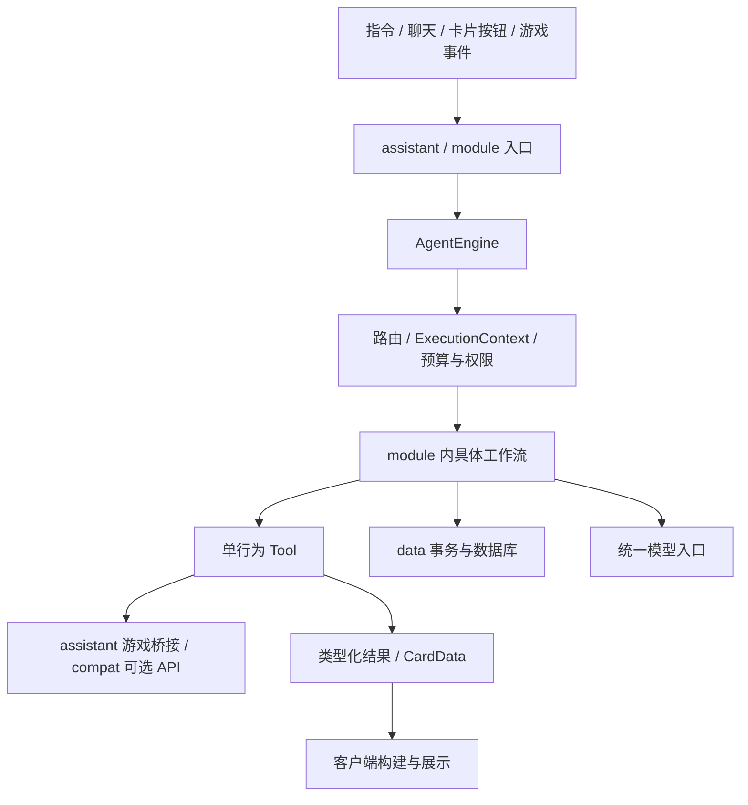

# 包职责与数据流

本次整理按职责分包，同时将商城、绑定、数据库、搜索和任务口播的所有权从 AgentEngine 移出。它们由 AssistantServer 在每个存档的服务实例中创建，通过 ModuleContext 显式提供给需要它们的模块。

## 代码放在哪里

| 包 | 内容 | 不承担的职责 |
| --- | --- | --- |
| `agent` | AgentEngine、交互/事件执行器、ExecutionContext、预算、取消、权限、会话记忆、路由和模型调用；AgentModule、AbstractAgentModule、ToolRegistry、AgentStore、AgentJournal、AgentLifecycle | 绑定文案、商城目录、报价、扣款、具体任务和游戏 API |
| `assistant` | MC 服务组装、玩家连接与绑定、请求分派、主线程桥接；游戏 Tool、交易与目录权限 | 意图路由算法、数据文件格式、卡片渲染 |
| `data` | 业务参数和结果、Codec、玩家文件事务与执行账本实现、共享/玩家数据库、注册表数据和提示词加载 | 工作流选择、游戏线程操作 |
| `module` | 功能契约与 ModuleManager；builtin 下的配置类型、入口、工作流和工具组合 | 通用执行预算、网络协议处理 |
| `speech` | ASR、TTS、播放会话与任务播报整理；quest 下的背景分类与缓存 | 商城和任务进度写入 |

网络、注册表、配置、界面、兼容层与通用工具保留原有职责。这里划分的是代码责任；公共 Codec、Identifier、文本组件仍使用 MC/DFU 类型，并未引入一个脱离 Minecraft 的独立构件。

具体位置：

- `module.builtin.<功能>`：Agent 工作流；本地知识查询和网络搜索工具也放在对应功能旁边。
- `assistant.tool.<功能>`：依赖 MC 业务的单行为 Handler；FTB 原生 API 仍隔离在 `compat.ftb`。
- `module.builtin.BuiltinTools`：共享工具类型键、输入 MapCodec 与输出 Codec，不执行工具。
- `data.input` / `data.output` / `data.result` / `data.search`：请求参数、查询结果、业务卡片结果与搜索规划数据。
- `data.store`：PlayerData、FileAgentStore、业务回执和 AgentJournalDataStorage；功能自己的存储继续位于 `module.builtin.storage`。
- `data.database` / `data.prompt`：数据库与知识索引；提示词快照、占位符与 txt reload listener。
- `speech.quest`：QuestNarration 与 QuestBackgrounds，通过统一模型入口计量。

## 装配与执行

AssistantServer 创建数据库、AgentEngine、SearchGateway、QuestNarration 和 ModuleManager。引擎构造参数只有 AgentStore、ModelClient 和事务内解析 AgentJournal 的函数；宿主将该函数映射到核心模块的账本存储。引擎和执行上下文因此不再直接调用 ModuleData 或 CoreSystemModule。

AssistantServer 使用单个 volatile INSTANCE：ServerStartedEvent 完成全部服务构建后发布，ServerStoppingEvent 先清空引用，再关闭玩家会话与资源；启动失败也清理已创建资源。`get(server)` 仍检查服务器对象是否匹配，避免上个存档的迟到回调访问新实例。不使用以 MinecraftServer 为键的全局 Map，不向 MinecraftServer 注入字段或添加对应 Mixin。

ModuleContext 的 AgentEngine 与模块注册表是构造器必需的固定字段，直接通过 engine() / modules() 读取。其他服务由 AssistantServer 注入 `Map<ContextType<?>, Object>`，模块通过 get 直接取得对应类型；内置键位于 ContextTypes，扩展可声明自己的 ContextType，无需增加上下文字段或构造参数。ModuleManager 在装配任何工具、工作流之前发布 ModuleContextEvent，供其他模组同步添加服务。各配置共享同一服务 Map，每个配置实例仍有自己的 owner ID 与工具实例缓存；ContextType 按对象身份匹配，名称只用于诊断。需要什么服务就传入对应工作流或 Tool 的构造器，不在静态模块定义中存服务器实例，也不让执行引擎成为业务服务查询器。

一个 Tool 只执行一个行为；Module 用 List 组合多个工具。ModuleRegistry、ToolRegistry 仍负责工具身份、owner、可用性和白名单，ExecutionContext 统一执行预算、写入回执及取消检查。新的功能不需要向 AgentEngine 添加业务字段或功能 ID 分支。

交易回执在事务内一次构建并带齐展示所需的奖池来源，工作流直接用 AgentResult.data 返回，不再借用预览请求对象、二次读取玩家存档或重建同一回执。语义路由直接复用 LexicalIndex 的 Match / Ranking，仅筛选和排序可用候选，不复制成同字段的另一套 DTO。

保留有独立职责的适配层：单行为 Tool 固定工具身份和执行标记，ModelGateway / SearchGateway 负责归属与计量，playerStore 视图在事务内校验玩家和运行代次，CommerceCatalogs 按模块权限生成可用目录。ModuleContext 共享服务引用，并为每个配置实例复用工具实例；需要跨配置共享生命周期时，可在安装期间调用 sharedRuntime(type, factory)，由 ModuleManager 按实例去重维护与关闭，不在静态模块定义里缓存运行时。

问答继续先查当前玩家/共享知识及授权的 FTB 说明书；仅在查无结果、本次允许联网且搜索模块启用时授权外部工具。授权集合属于单次 ExecutionContext，选择工作流时重置，每次搜索/抓取再次检查。Agent 只提供通用外部工具授权接口，数据库优先和搜索规则由 QuestionModule / WebResearch 实现。

## 线程与生命周期

游戏 API 仍经 MinecraftTools / GameTaskQueue 在服务端线程操作；文件读写、模型和网络等待在有界后台队列中执行。QuestNarration 使用独立工作队列，通过 engine.background 创建带玩家运行代次、对话代次与预算检查的上下文，首张卡片不等待模型整理。

AssistantBindings 负责绑定事务和清理业务文件。撤销/重置调用 engine.invalidatePlayer，先切换运行代次、取消交互、禁用事件规则并清理路由，然后在维护线程通知 AgentLifecycle.revoked，再执行数据删除。交易服务清空自己的报价，数据库删除玩家独立库，口播服务取消自己的在途任务，FTB 清理领取引用；共享知识和独立用量账本保留。

AgentLifecycle.disconnected 和 accessChanged 在调用方线程执行，只用于快速取消与缓存失效；涉及磁盘的清理放在 revoked 维护阶段。业务回调仍使用 context.store 或提交时捕获的 engine.playerStore，旧代次回调不能重建已经删除的数据。

关闭服务时按创建顺序的逆序释放：模块会话与工作者、任务口播、搜索、Agent 执行器/模型/玩家文件，最后数据库；某个资源关闭失败会记录日志并继续释放其他资源。创建中途失败也使用同一资源列表收尾。

此次调整保持注册表 ID、持久化 Codec 字段、网络协议 1 和可选依赖的隔离方式。它改变 Java 类型路径和装配 API，其他 Java 扩展需要更新导入及构造调用。验证范围见[编译与验收](testing.md)。
