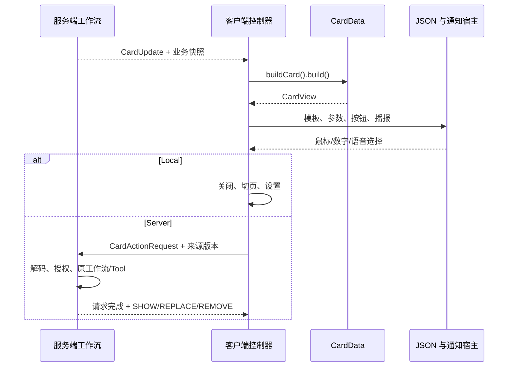

# 卡片与消息数据流

状态：已按本稿实施，2026-10-28。以下结论来自源码与编译检查，游戏内验收仍待进行；不提供旧开发存档或旧网络结构兼容。JSON 语法与扩展实例见[客户端 JSON 卡片](cards.md)。

## 工作流程与边界

**服务端处理数据 → CardData 快照发客户端 → buildCard().build() → CardView → JSON 渲染 → 点击按钮 → 本地执行或发包到服务端。**

| 层 | 职责 | 主要入口 |
| --- | --- | --- |
| 服务端 | 查询、授权、交易、发奖、准备任务播报、决定更新 | AssistantRequests、AgentModule/Tool、FTB 适配层 |
| 公共契约 | Codec、不可变业务快照和纯展示说明 | card/CardData、CardBuilder、CardView、CardUpdate |
| 客户端 | 翻译、模板、物品与 tooltip、页面、HUD、语音 session | card/client、screen/card、AssistantMessages |

公共契约不引用客户端、AUI、服务端运行时或 FTB API。CardData.buildCard 只读自己的字段；不能查询游戏状态、请求模型、发包或生成随机业务凭证。物品以 ItemStackTemplate/预览 DTO 传递，Component 保留翻译键和样式。TTS/ASR 密钥、配置和用量仅留客户端。

## 一次描述，一次构建

[CardData](../src/main/java/com/iafenvoy/system/card/CardData.java) 提供 codec() 与 buildCard()。各实现通过 [SystemCardDataTypes](../src/main/java/com/iafenvoy/system/registry/SystemCardDataTypes.java) 注册 MapCodec，根 Codec 按 type 分派；不再提供独立 template/buildContext，也不登记渲染工厂或 ClientCardBindings。

[CardBuilder](../src/main/java/com/iafenvoy/system/card/CardBuilder.java) 一处设置模板、summary、可选标题、平铺参数、按钮和 SpeechContent。build 复制为 [CardView](../src/main/java/com/iafenvoy/system/card/CardView.java)。CardContext 仍是 states、parameters、callbacks 三表，整张卡片一份；公共构建不接收 Runnable。客户端 CardPresentation 解析 Component/CardText，补模式、标签和版本受控 callback 后渲染。

普通消息沿用同一数据流：**仅一个纯文本节点、没有按钮、没有其他可见内容**时省去卡片外框；带按钮的文字仍是卡片。容器、物品、分割线、多节点等继续作为卡片。该约定由通用渲染入口判定。

## 完整 DTO

| DTO | 服务端提前提供的信息 |
| --- | --- |
| ItemPageOutput | query、nextOffset、hasMore、ItemStackTemplate |
| ShopOfferOutput / ShopQuoteOutput | 商品 ID、目录版本、可报价状态 / 独立 quoteRef |
| LotteryPoolOutput / PurchaseReceiptOutput | 报价和确认状态 / 来源奖池；再抽一次重新报价 |
| RewardOutput | 实际签到结果主句、原因、可选投递引用 |
| QuestOutput | 标题、要求、奖励、可提交状态、领取引用、自选项、游标、全任务剩余奖励标志、SpeechContent |
| QuestList | 服务端列表编号与任务快照；直接配对查看按钮 |
| QuestNotice | COMPLETED/UNLOCKED、当前可操作状态、奖励入口、播报段落 |
| StarterGiftOutput | 全部匹配礼包的物品、引用和必要错误；不显示来源任务名称 |
| BindingCardData | 宿主名和系统名称/介绍翻译键；本地打开按钮 |

客户端不反查工作流输入、不推断是否能领奖、不补造订单或领取引用。工具内部输出不必都实现 CardData。

## 明确按钮，不按翻译键猜动作

CardAction 只有 Local 和 Server，均描述 Identifier + Map<String,String>。CardButton 另含卡片内 id、labelKey、BODY/FOOTER、CLOSE/WAIT/REPLACE。

- Local 通过客户端处理器 Map 执行，模块可用 ClientModuleContext.localAction 扩展。打开页面后按正常页面入口加载数据。
- Server 发 CardActionRequest，携带来源 CardRef 和动作描述；玩家从连接取得，不接受客户端指定身份。动作 ID 复用 SystemActionTypes。
- ModuleRouting.button 声明字符串参数转换器；ModuleRegistry 解码并用原参数 Codec 校验，再进入相同的 AgentModule/Tool 工作流。按钮是明确操作，不走语义识别或模型选择。
- source 只负责定位和版本，不能替代所有权、模块权限、Cost、订单、领取引用与幂等校验。

CLOSE 停止旧语音/录音并关闭通知；WAIT 保留通知并在等待期间禁用服务端操作。REPLACE 是服务端按钮的默认行为：等待直接回复后，用回复的新 SHOW 卡片替换来源通知的展示位置。切换复用淡出/淡入、停止旧语音与录音，面板保持展开；其他通知继续按原顺序等待。这是客户端展示调度，不改变 CardUpdate.REPLACE 按同一 ID 静默更新的协议语义。通知不设可见时长，播报结束不推进队列；确认、关闭、明确按钮操作或服务端更新才结束或替换当前通知。收到失败、请求超时或无卡片回复也能解除等待。鼠标、数字和语音共用 CardController，旧通知版本的语音结果不能操作新消息。

JSON 只安排已声明按钮，不得定义动作、指令或脚本。BODY 按钮进入正文滚动列表，FOOTER 由 HUD 代码生成，始终在业务按钮之后补本地确定。简约模式保留文字编号选择。

## ID、版本与请求生命周期

CardRef 为 UUID + revision，CardUpdate 支持：

| 模式 | 内容及效果 |
| --- | --- |
| SHOW | 带 CardData，新消息、新 ID |
| REPLACE | 带完整新快照，只更新指定 ID；不新增历史、通知或播报 |
| REMOVE | 无数据，结束活动展示；历史保留最后只读内容 |

ClientCards 忽略重复/旧版本，保留移除标记；未知 ID 的 REPLACE 不弹新通知。关闭后的通知不因替换重新出现。ServerCards 仅保留连接内已发布版本元数据，在动作开始时预留版本，异步完成时核对代次；不保存 Builder、DOM 或 callback。断线、revoke/reset 清理相关代次和本地状态。

ReplyResponse 完成对应 requestId，零卡片同样完成；NoticeResponse 是独立推送，仍进入普通 FIFO 队列。客户端 pending 保存发起页面，以及从 HUD 激活 REPLACE 按钮时的来源 CardRef；回复仅在来源通知仍为当前通知时原位显示，不抢占其他通知。手动确认或关闭后收到的结果仍更新会话记录，但不重新弹出 HUD。完整/简约页面操作不记录通知来源，迟到结果不能抢新页面。等待超时后，已有卡片的有效 REPLACE/REMOVE 仍可更新，迟到 SHOW 不新开消息。

状态和历史使用 StateResponse、HistoryResponse。历史保存业务 DTO 快照及消息元信息，不保存视图对象或 callback；恢复只读，不播报、不发包、不恢复旧领取/购买按钮的执行权限。

## 任务、礼包与绑定

任务完成事件由服务端读取最终进度与奖励，发送完成通知。领取后重新查询完整剩余奖励状态：有剩余时 REPLACE，无剩余时 REMOVE；客户端不按分页可见奖励猜测。

新手礼包聚合所有匹配任务，显式领取后静默替换剩余列表，无剩余就移除，不再提示“领取处理完成”。任务明确提交后未完成才显示进度；完成时请求静默结束，由 FTB 事件发送唯一完成通知。

首次绑定按“绑定消息 → 新手礼包 → 当前可执行任务”入队；不存在的项跳过，重新登录不重复引导。

## 播报、缓存与富文本

SpeechContent 分 main、requirements、rewards、descriptions。未设 speech 默认 summary；显式 EMPTY 不播报。客户端只按个人开关拼接，TTS 不再发任务播报查询包。

可格式化的要求与奖励由 FTB 服务端适配器整理；不熟悉的类型及“是否为背景描述”由 QuestNarration/QuestBackgrounds 整理和缓存。缓存关联任务 ID、语言、提示词、模型与内容指纹；背景正负判断保存在存档根目录 system-quest-backgrounds.json。首次卡片不等待 AI，先展示已有结构化内容，后台结果供后续卡片使用，不追加到正在播放的消息。

FTB 的 § 在适配入口解析为 Component，客户端安全转为格式片段，换行和字段边界收束样式，不解释成 HTML。播报去样式。“叮”保留在明确的主句里；提示音仅在通知队列首次展开时播放。切换、确认、关闭、REMOVE 以及 WAIT/REPLACE 按钮操作都停止旧 session，下一条不等旧音频结束。

## AgentResult 与 BuiltinTools

AgentResult 继承 Saturn ResultWithData<List<CardUpdate>>。Status 为 SUCCEEDED、FAILED、PARTIALLY_SUCCEEDED，Codec 使用稳定小写字符串；部分成功仍带 Failure，不能写成功缓存。投递模式与执行状态分开。便捷 ok/error 为普通文字创建 TextCardData，显式零更新回复不额外生成消息。

[BuiltinTools](../src/main/java/com/iafenvoy/system/agent/builtin/tool/BuiltinTools.java) 仍是工具契约清单，每个常量为 ToolRegistry.Type<I,O>，声明工具 ID、输入 MapCodec 和输出 Codec。实际操作在 Handler，模块用 List 组合并复用同一 Tool 实例；ExecutionContext 统一检查权限、预算、写入与幂等回执。输入 Codec 用于参数指纹，输出 Codec 用于恢复结果。它不负责布局、消息按钮或客户端注册。

## 校验范围

已完成主源码与开发源集编译，未启动 Minecraft 或执行运行时验收。需要在游戏内验收：首次绑定顺序、资源覆盖、长任务列表、两张同类型卡片独立替换、历史只读、WAIT 失败/超时恢复、语音中断、物品 tooltip 和纯文本/带按钮卡片的视觉效果。详细执行记录见[编译与验收](testing.md)。
