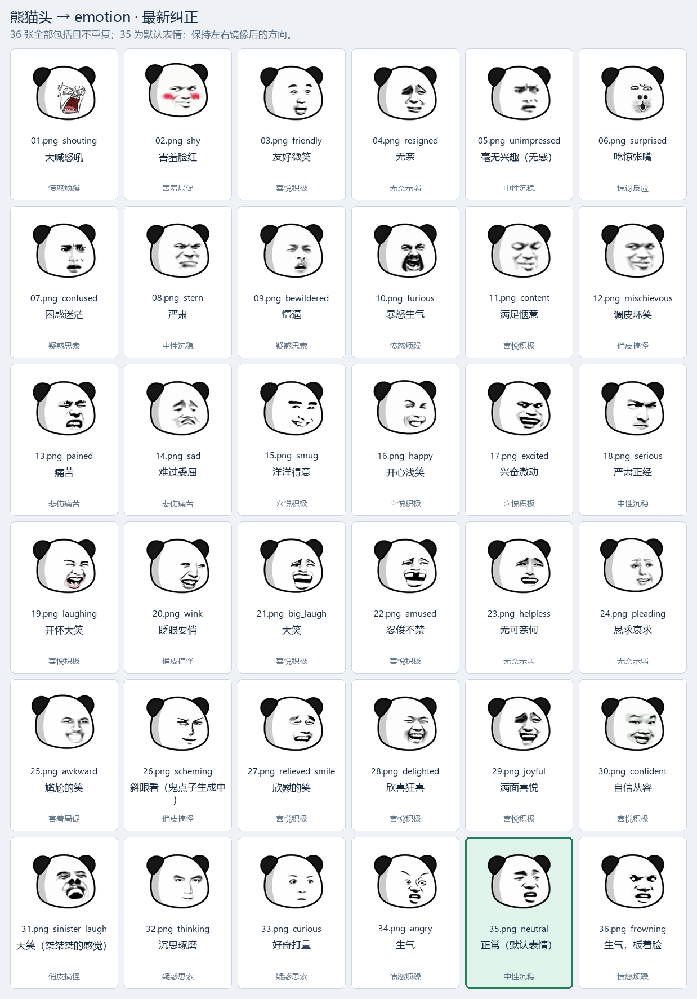
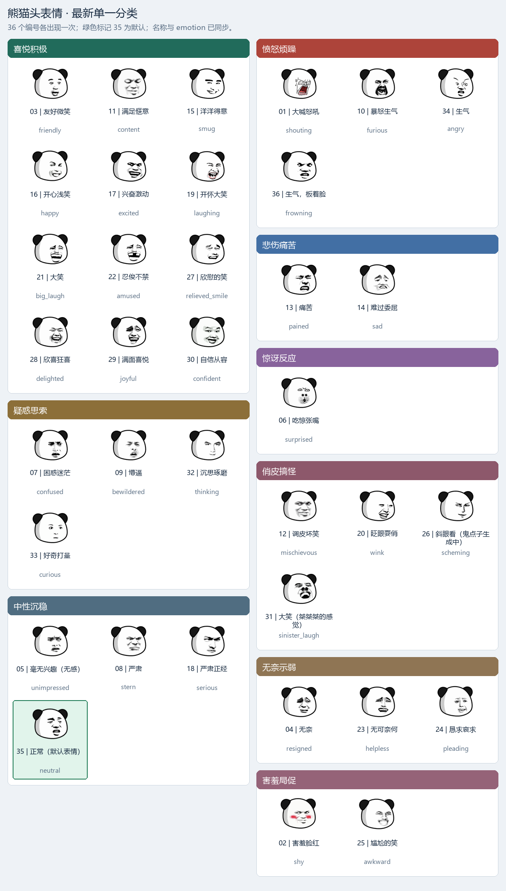

# 自由聊天表情

自由模式和扩展模式的聊天回复在 Markdown 左侧显示表情。服务端发送 `ChatOutput(answer, emotion)`，emotion 使用 `system:happy` 等完整注册表 ID；客户端的 `system:emotion` 节点读取状态 ID 并绘制，同时更新独立的表情 HUD。状态机、贴图、动画和资源重载均留在客户端，不向服务端发送资源包内容，也不增加模型调用。

默认 `system:panda` 使用用户提供的《熊猫头单独带表情36个_爱给网_aigei_com.rar》中的 36 张独立图片；两张总览图不进入模组。图片使用相同裁剪范围和透明画布，只保留 36 张 192×192 PNG，全部已左右镜像。说话复用原图，以 `(-2, -2)`（左上）和 `(2, 2)`（右下）两个绘制偏移交替，不再保存重复的说话贴图。

## 模型输出与播报

自由聊天通过原生 `answer` 函数返回 `{"text":"…","emotion":"system:happy"}`。服务端从数据包注册表 `system:emotion` 生成 AI 的 ID / 名称 / 介绍 / 分类目录，注入 `{{emotion_catalog}}`，不再在 TXT 中按编号硬编码 36 个表情。省略 emotion 或传空字符串会清除并隐藏独立 HUD，仅有明确表情时显示；显式传 `system:neutral` 可显示 35 号默认表情。聊天历史卡片的空表情仍使用资源包 `default_state`。历史保存正文和表情，但发送给模型的历史仍只有原来的文字。

## 表情 HUD 与客户端指令

`SystemHudEntries.EMOTION` 以 `system.emotion` 注册到 Saturn 自带 HUD 编辑器，默认在左上角，左、上各留 12 个 GUI 像素。使用右 Shift 或 `/saturn hud open` 移动、更换锚点与控制显隐，位置沿用 `config/saturn/hud.json`；`/saturn hud system.emotion reset` 恢复默认位置，已有布局不会被自动覆盖。编辑器内始终预览实际熊猫头。HUD 跟随设置页选择的系统样式：中央方框与系统主面板共用 `--assistant-window` 背景色，边框和四角横、竖色条使用当前主题的强调色。切换样式即时更新，首次创建及资源重载后也会应用已保存的选择；颜色定义共用 `assistant-theme.css`，无需加载整份页面布局。外部区域透明，不铺全屏遮罩，也不接收鼠标或键盘事件。初始和清除后隐藏；有表情时在普通游戏和游戏内 GUI 中显示，设置等菜单暂时隐藏；F1 和 Saturn 的显隐选项优先。

简约模式界面打开时也保留表情 HUD，与普通游戏中的显示状态一致；无表情或清除状态后仍隐藏。完整模式和设置菜单继续沿用原有显示条件。

HTML / CSS 可通过资源包覆盖 `assets/apricityui/apricity/system/assistant-emotion.html` 和 `assistant-emotion.css`。固定尺寸的布局不会在说话时变更；静止 / 说话帧只重新绘制贴图和偏移。指令根节点下只有 literal 子命令，表情 ID 参数放在 `set` 下；speaking 的 true / false / auto 也全部使用 literal。

下列命令在系统界面输入框使用 `/emotion`，在原版聊天栏使用 `/system emotion`；系统界面也接受完整的 `/system emotion` 前缀。表情是单独注册的客户端调试入口，无需 OP、不要求绑定系统，执行不发送网络请求，也不修改服务端或玩家存档。其他模块指令仍仅在系统界面输入，不会随此入口导出。

例如在游戏聊天栏输入 `/system emotion set system:happy`、`/system emotion speaking true` 或 `/system emotion clear`，即可切换表情、测试说话动画或清除状态。两处复用同一棵表情指令声明，补全和执行行为一致：

| 命令 | 行为 |
| --- | --- |
| `/emotion` | 查看当前 profile 和状态 |
| `/emotion list` | 按当前数据定义列出状态和名称 |
| `/emotion set system:happy` | 切换 HUD 表情，参数支持注册表及当前资源配置的补全 |
| `/emotion speaking true` | 强制开启两帧说话动画 |
| `/emotion speaking false` | 强制关闭说话动画 |
| `/emotion speaking auto` | 恢复跟随当前回复的实际播报 |
| `/emotion show false` / `true` | 本地暂时隐藏 / 显示 HUD |
| `/emotion profile example:assistant` | 选择已加载的客户端贴图配置 |
| `/emotion clear` | 清除当前回复关联及说话覆盖，隐藏整个 HUD，直到收到明确表情或手动显示 |
| `/emotion reset` | 恢复默认 profile / 表情及自动播报状态 |

本地测试状态只存当前连接内存；收到一条新的有效服务端聊天卡片（SHOW 或带数据的 REPLACE）时，即使表情 ID 与上一条相同，也立即覆盖本地 profile / 表情 / 说话开关及临时隐藏状态。有明确表情时显示并跟踪这条回复的播报，空表情则清除并隐藏；当前关联的卡片被删除或替换为非聊天卡片时也清除。Saturn 编辑器保存的显隐偏好不会被服务端更改。查看历史、重复或过期卡片不会覆盖当前表情。断开连接清除本地测试状态。

## 数据包语义注册表

正式同步注册表为 `system:emotion`，键是 `SystemResourceKeys.EMOTION`，条目 Codec 为 `EmotionDefinition.CODEC`。定义文件为 `data/<namespace>/system/emotion/<path>.json`，ID 为 `<namespace>:<path>`。编号只是内置贴图的文件名，不决定表情含义或 ID；新增表情不需要改 Java、TXT 枚举或重编号。

```json title="data/example/system/emotion/proud.json"
{
  "name": "自豪",
  "description": "完成困难目标后的自豪微笑。",
  "category": "喜悦积极",
  "order": 10
}
```

| 字段 | 类型 | 必填 / 默认 | 用途 |
| --- | --- | --- | --- |
| `name` | string | 必填 | 表情可读名称，用于 AI 目录和命令提示；此处为语义文字，不是翻译键 |
| `description` | string | `""` | 补充含义，帮助 AI 区分相似表情 |
| `category` | string | `""` | 可选分组，不参与状态判断 |
| `order` | int | `0` | AI 目录顺序，越大越靠前，相同则按 ID 排序 |

服务端提供语义，客户端资源包提供相同 ID 的贴图映射，互不要求加载对方的类；服务端不访问 AUI、纹理或客户端资源管理器。新增 / 修改该数据包注册表需要重进世界或重启服务端，随后自动同步到客户端；TXT 提示词仍可 `/reload`，新执行持有同一版本的表情目录。单独新增客户端状态也可用 emotion 指令测试，但 AI 只能从服务端目录获知它。

表情和说话是两层状态：先选择情绪，再在该情绪的 `speaking` 帧间循环。`AssistantSpeech` 按卡片 UUID 跟踪当前实际播音的消息；提示音、排队、合成加载、暂停、预览和其他消息的语音不会启动这张卡片的动作。播放结束、失败或取消后恢复情绪的静止贴图。关闭自动播报仍可正常显示静止表情。

每张卡片单独持有状态，DOM 重绘保留状态，关闭界面后不会强持有其元素。动画采样返回不可变的 `EmotionFrame(Identifier texture, Offset offset)`，纹理或 offset 变化都会请求重绘，不逐帧修改 CSS、属性、尺寸或布局，也不读取贴图文件或生成新纹理。纹理使用原版资源管理器，支持正常资源包覆盖。

## 资源包定义

定义位置为 `assets/<namespace>/emotion/<path>.json`，对应 ID `<namespace>:<path>`。PNG 放在 `assets/<namespace>/textures/…` 下，JSON 中填写原版纹理 ID。

```json title="assets/example/emotion/assistant.json"
{
  "default_state": "example:neutral",
  "transitions": { "celebrate": "example:proud", "reset": "example:neutral" },
  "states": {
    "example:neutral": {
      "texture": "example:textures/assistant/neutral.png",
      "speaking": [
        { "texture": "example:textures/assistant/neutral.png", "offset": { "x": -2, "y": -2 } },
        { "texture": "example:textures/assistant/neutral.png", "offset": { "x": 2, "y": 2 } }
      ],
      "frame_time": 180
    },
    "example:proud": {
      "texture": "example:textures/assistant/happy.png",
      "duration": 3000,
      "next": "example:neutral",
      "transitions": { "calm_down": "example:neutral" }
    }
  }
}
```

| 定义字段 | 类型 | 必填 / 默认值 | 含义 |
| --- | --- | --- | --- |
| `default_state` | string | 必填 | 缺省 / 未知情绪及缺图时的回退状态，必须存在于 states；内置为 `system:neutral` |
| `states` | object | 必填 | 完整表情 ID（如 `example:proud`）→ 客户端状态定义 |
| `transitions` | object | `{}` | 所有状态共用的事件名 → 目标状态 |

| 状态字段 | 类型 | 必填 / 默认值 | 含义 |
| --- | --- | --- | --- |
| `texture` | Identifier 或帧对象 | 必填 | 静止贴图；字符串等价于 offset 为零的帧 |
| `speaking` | 帧数组 | `[]` | 说话循环帧；每项支持 Identifier 字符串或帧对象，空数组保持静止，可超过两帧 |
| `frame_time` | int | `180` | 每帧毫秒数；运行时至少 1ms |
| `duration` | int | `0` | 状态持续毫秒数；大于 0 时启用定时跳转 |
| `next` | string | `""` | 定时跳转目标，空时回 default_state |
| `transitions` | object | `{}` | 当前状态优先使用的事件名 → 目标状态 |

| 帧字段 | 类型 | 必填 / 默认值 | 含义 |
| --- | --- | --- | --- |
| `texture` | Identifier | 必填 | 原版纹理 ID；多帧可以引用同一张 PNG |
| `offset` | object | `{"x":0,"y":0}` | 仅在绘制时生效的位移，单位为 AUI 文档像素，跟随页面整体缩放 |
| `offset.x` | float | `0` | 正数向右、负数向左 |
| `offset.y` | float | `0` | 正数向下、负数向上 |

事件查找顺序为当前状态、全局、同名状态。自动播音会发送 `speech_started` / `speech_finished`；未配置它们时只切换说话帧，不改变情绪。定时跳转每次更新最多执行一次，错误的循环不会阻塞主线程。保持头像尺寸稳定需要各帧使用相同画布和对齐方式。

资源重载校验默认状态、完整状态 ID 和跳转目标；坏的高优先级 JSON 尝试较低资源包，并记录文件和异常。不存在的 profile 回退到 `system:panda` 并记录警告，不重新请求模型。

贴图存在性在资源重载时缓存，动画采样不读文件。目标状态不存在则回退默认状态；目标静止 / 说话帧缺失则直接使用 profile 的默认静止贴图（内置 `system:neutral` / 35）；默认贴图也缺失时渲染 Minecraft 的紫黑棋盘 `missingno`。缺少一张贴图不会拒绝整份 profile；日志包含 profile、状态和缺失路径，同一问题每轮资源重载只记录一次。修改客户端 JSON / PNG 后执行资源重载；修改服务器 TXT 提示词使用 `/reload`。

## 内置图片与 emotion 对照

以用户最新纠正为准，36 张图各绑定一个唯一 emotion、一个名称和一个分类，不设置重复别名。默认状态 `system:neutral` 对应 **35 号“正常（默认表情）”**，用于未知状态回退、reset 事件和显式的中性表情。省略 emotion 会隐藏独立 HUD，历史卡片仍使用默认表情。26 号改为 `system:scheming`，表示斜眼看、鬼点子生成中。

04 已补为 `system:resigned`（无奈），与 23 号 `system:helpless`（无可奈何）分别保留。19 / 21 / 31 都是笑，但区分为开怀大笑 / 大笑 / 桀桀桀的邪笑。10 / 34 / 36 分别为暴怒生气 / 生气 / 生气板脸。08 / 18 分别保留严肃 / 严肃正经。所有静止及说话帧沿用已左右镜像的贴图，不再次翻转。

名称、介绍及单一分类保存在 [数据包 emotion 定义](../src/main/resources/data/system/system/emotion)中；[`system:panda` 资源配置](../src/main/resources/assets/system/emotion/panda.json)只负责贴图和动画。编辑器同步两份来源。下图为便于阅读仅标出 ID 的路径部分，例如 happy 的完整 ID 为 `system:happy`。





| 图片 | emotion（状态名） | 修正名称 | 一级大类 |
| --- | --- | --- | --- |
| [01.png](../src/main/resources/assets/system/textures/emotion/panda/01.png) | `system:shouting` | 大喊怒吼 | 愤怒烦躁 |
| [02.png](../src/main/resources/assets/system/textures/emotion/panda/02.png) | `system:shy` | 害羞脸红 | 害羞局促 |
| [03.png](../src/main/resources/assets/system/textures/emotion/panda/03.png) | `system:friendly` | 友好微笑 | 喜悦积极 |
| [04.png](../src/main/resources/assets/system/textures/emotion/panda/04.png) | `system:resigned` | 无奈 | 无奈示弱 |
| [05.png](../src/main/resources/assets/system/textures/emotion/panda/05.png) | `system:unimpressed` | 毫无兴趣（无感） | 中性沉稳 |
| [06.png](../src/main/resources/assets/system/textures/emotion/panda/06.png) | `system:surprised` | 吃惊张嘴 | 惊讶反应 |
| [07.png](../src/main/resources/assets/system/textures/emotion/panda/07.png) | `system:confused` | 困惑迷茫 | 疑惑思索 |
| [08.png](../src/main/resources/assets/system/textures/emotion/panda/08.png) | `system:stern` | 严肃 | 中性沉稳 |
| [09.png](../src/main/resources/assets/system/textures/emotion/panda/09.png) | `system:bewildered` | 懵逼 | 疑惑思索 |
| [10.png](../src/main/resources/assets/system/textures/emotion/panda/10.png) | `system:furious` | 暴怒生气 | 愤怒烦躁 |
| [11.png](../src/main/resources/assets/system/textures/emotion/panda/11.png) | `system:content` | 满足惬意 | 喜悦积极 |
| [12.png](../src/main/resources/assets/system/textures/emotion/panda/12.png) | `system:mischievous` | 调皮坏笑 | 俏皮搞怪 |
| [13.png](../src/main/resources/assets/system/textures/emotion/panda/13.png) | `system:pained` | 痛苦 | 悲伤痛苦 |
| [14.png](../src/main/resources/assets/system/textures/emotion/panda/14.png) | `system:sad` | 难过委屈 | 悲伤痛苦 |
| [15.png](../src/main/resources/assets/system/textures/emotion/panda/15.png) | `system:smug` | 洋洋得意 | 喜悦积极 |
| [16.png](../src/main/resources/assets/system/textures/emotion/panda/16.png) | `system:happy` | 开心浅笑 | 喜悦积极 |
| [17.png](../src/main/resources/assets/system/textures/emotion/panda/17.png) | `system:excited` | 兴奋激动 | 喜悦积极 |
| [18.png](../src/main/resources/assets/system/textures/emotion/panda/18.png) | `system:serious` | 严肃正经 | 中性沉稳 |
| [19.png](../src/main/resources/assets/system/textures/emotion/panda/19.png) | `system:laughing` | 开怀大笑 | 喜悦积极 |
| [20.png](../src/main/resources/assets/system/textures/emotion/panda/20.png) | `system:wink` | 眨眼耍俏 | 俏皮搞怪 |
| [21.png](../src/main/resources/assets/system/textures/emotion/panda/21.png) | `system:big_laugh` | 大笑 | 喜悦积极 |
| [22.png](../src/main/resources/assets/system/textures/emotion/panda/22.png) | `system:amused` | 忍俊不禁 | 喜悦积极 |
| [23.png](../src/main/resources/assets/system/textures/emotion/panda/23.png) | `system:helpless` | 无可奈何 | 无奈示弱 |
| [24.png](../src/main/resources/assets/system/textures/emotion/panda/24.png) | `system:pleading` | 恳求哀求 | 无奈示弱 |
| [25.png](../src/main/resources/assets/system/textures/emotion/panda/25.png) | `system:awkward` | 尴尬的笑 | 害羞局促 |
| [26.png](../src/main/resources/assets/system/textures/emotion/panda/26.png) | `system:scheming` | 斜眼看（鬼点子生成中） | 俏皮搞怪 |
| [27.png](../src/main/resources/assets/system/textures/emotion/panda/27.png) | `system:relieved_smile` | 欣慰的笑 | 喜悦积极 |
| [28.png](../src/main/resources/assets/system/textures/emotion/panda/28.png) | `system:delighted` | 欣喜狂喜 | 喜悦积极 |
| [29.png](../src/main/resources/assets/system/textures/emotion/panda/29.png) | `system:joyful` | 满面喜悦 | 喜悦积极 |
| [30.png](../src/main/resources/assets/system/textures/emotion/panda/30.png) | `system:confident` | 自信从容 | 喜悦积极 |
| [31.png](../src/main/resources/assets/system/textures/emotion/panda/31.png) | `system:sinister_laugh` | 大笑（桀桀桀的感觉） | 俏皮搞怪 |
| [32.png](../src/main/resources/assets/system/textures/emotion/panda/32.png) | `system:thinking` | 沉思琢磨 | 疑惑思索 |
| [33.png](../src/main/resources/assets/system/textures/emotion/panda/33.png) | `system:curious` | 好奇打量 | 疑惑思索 |
| [34.png](../src/main/resources/assets/system/textures/emotion/panda/34.png) | `system:angry` | 生气 | 愤怒烦躁 |
| [35.png](../src/main/resources/assets/system/textures/emotion/panda/35.png) | `system:neutral` | 正常（默认表情） | 中性沉稳 |
| [36.png](../src/main/resources/assets/system/textures/emotion/panda/36.png) | `system:frowning` | 生气，板着脸 | 愤怒烦躁 |

### 按大类查看

| 一级大类 | 二级表情（编号 · 修正名称 · emotion） |
| --- | --- |
| 喜悦积极 | 03 · 友好微笑 · `system:friendly`；11 · 满足惬意 · `system:content`；15 · 洋洋得意 · `system:smug`；16 · 开心浅笑 · `system:happy`；17 · 兴奋激动 · `system:excited`；19 · 开怀大笑 · `system:laughing`；21 · 大笑 · `system:big_laugh`；22 · 忍俊不禁 · `system:amused`；27 · 欣慰的笑 · `system:relieved_smile`；28 · 欣喜狂喜 · `system:delighted`；29 · 满面喜悦 · `system:joyful`；30 · 自信从容 · `system:confident` |
| 愤怒烦躁 | 01 · 大喊怒吼 · `system:shouting`；10 · 暴怒生气 · `system:furious`；34 · 生气 · `system:angry`；36 · 生气，板着脸 · `system:frowning` |
| 悲伤痛苦 | 13 · 痛苦 · `system:pained`；14 · 难过委屈 · `system:sad` |
| 惊讶反应 | 06 · 吃惊张嘴 · `system:surprised` |
| 疑惑思索 | 07 · 困惑迷茫 · `system:confused`；09 · 懵逼 · `system:bewildered`；32 · 沉思琢磨 · `system:thinking`；33 · 好奇打量 · `system:curious` |
| 俏皮搞怪 | 12 · 调皮坏笑 · `system:mischievous`；20 · 眨眼耍俏 · `system:wink`；26 · 斜眼看（鬼点子生成中） · `system:scheming`；31 · 大笑（桀桀桀的感觉） · `system:sinister_laugh` |
| 中性沉稳 | 05 · 毫无兴趣（无感） · `system:unimpressed`；08 · 严肃 · `system:stern`；18 · 严肃正经 · `system:serious`；35 · 正常（默认表情） · `system:neutral` |
| 无奈示弱 | 04 · 无奈 · `system:resigned`；23 · 无可奈何 · `system:helpless`；24 · 恳求哀求 · `system:pleading` |
| 害羞局促 | 02 · 害羞脸红 · `system:shy`；25 · 尴尬的笑 · `system:awkward` |

## 卡片节点

```json
{ "type": "system:emotion", "profile": "example:assistant", "state": "{{emotion}}", "size": 72 }
```

`profile`、`state` 均支持占位符；默认分别为 `system:panda`、`{{emotion}}`。`size` 默认 72，固定方形区域，CSS 类为 `card_emotion`。默认聊天布局在 `assets/system/cards/chat.json`，可直接在资源包中换 profile、移动或删除节点。它不是文本节点，不会被当作纯文本消息折叠，朗读内容仍由 ChatOutput 的正文提供。

Card JSON 编辑器认识此节点，内置语义定义、客户端配置和 PNG 随 `npm run sync:resources` 同步。编辑器根据 Context 的 `emotion` 显示静止帧；实际播音、事件和超时由游戏中的状态机执行。

## 代码扩展

服务端可直接构造 `new ChatOutput("你好", "system:happy")`，或以原有卡片 REPLACE 机制更新表情。状态只是展示数据，不授权任何工具或游戏操作。

客户端可在已有 `CardBuildEvent` 中用 `event.builder().put("emotion", "system:smug")` 设置初始状态。界面渲染后，其他模组可在客户端主线程控制指定卡片的所有表情节点：

```java
AssistantEmotions.control(cardId, machine -> machine.setState("system:happy"));
AssistantEmotions.control(cardId, machine -> machine.signal("celebrate"));
AssistantEmotions.control(cardId, machine -> machine.setSpeaking(true));
AssistantEmotions.control(cardId, machine -> machine.setSpeaking(null)); // Resume automatic speech tracking.
AssistantEmotions.control(cardId, EmotionStateMachine::reset);
```

控制独立 HUD 使用 `EmotionHudState.machine().setState("example:proud")`，并以 `EmotionHudState.shown(true)` 显示；说话覆盖使用 `setSpeaking(true)` 或 `setSpeaking(null)`。`EmotionHudState.shown(false)` 仅临时隐藏，保留状态；`EmotionHudState.clear()` 清除当前回复关联和说话覆盖，并隐藏 HUD。它们与 emotion 命令共用同一份客户端状态，下一条服务端状态会覆盖本地控制。

`AssistantEmotions` 和 `EmotionStateMachine` 位于 `screen.emotion`。`cardId` 是 CardReference 的 UUID。控制接口只作用于当前已创建并仍被界面持有的状态机，不为尚未渲染的消息排队；需要持久化或在渲染前生效时应修改 CardData / CardBuilder。管理器使用弱引用，不持有 Document，断开连接时清空。

本次执行 Java / 开发源集编译、编辑器生产构建和资源静态核对，未启动 Minecraft、未请求真实模型或语音服务；实际 HUD 排版、编辑拖动、服务端覆盖及缺图显示仍待游戏内验收。
